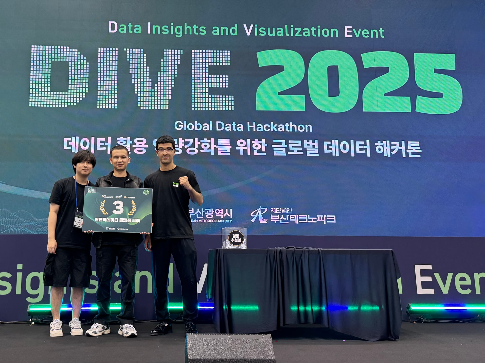

## 01 · the problem

### At sea, a watch is easier to reach than a phone.

On a boat or a pier, a phone is often in a bag or a pocket, and hands are wet or busy. A watch is always on the wrist. Breeze puts safety and fishing information there, for fishermen, divers and anyone else out on the water.

We built it at DIVE 2025, a global data hackathon in Busan, for the coastal big data platform track: teams had to build something useful from coastal and marine data.

## 02 · what it does

### Safety first, fishing second.

- **Emergency call.** Tapping the screen three times in quick succession calls 112, Korea's emergency number. The watch also reads the wearer's heart rate and blood pressure from Apple Health.
- **Alerts.** Warnings for bad weather and typhoons, using typhoon data from the Korea Meteorological Administration.
- **Fishing advice.** The watch sends the current conditions to Google's Gemini AI model, which scores them from 0 to 10 for fishing, suggests which fish to target and the best times of day, and recommends spots. The answer comes back in a fixed format the watch can display directly.
- **Cards.** Swipeable screens for tide times, with the moon phase and a tide graph, for marine weather, and for nearby fishing spots with their depth and seabed type.

## 03 · my part

### The Apple Watch app, in SwiftUI.

We were three uni mates. Two of us built the Apple Watch app in Swift with SwiftUI, Apple's framework for building interfaces, and our third teammate built the Android watch version (Wear OS) in Kotlin on his own.

On the Apple Watch app, I built:

- location tracking and the navigation between cards
- the tide card, including the tide graph
- the weather and typhoon alerts
- the triple-tap emergency call and the health readings
- the AI fishing advice

My teammate built the weather and fishing spot cards.

## 04 · result

### Third place.

Breeze took third place in the coastal big data platform track at DIVE 2025.

Third place at DIVE 2025, Busan.

