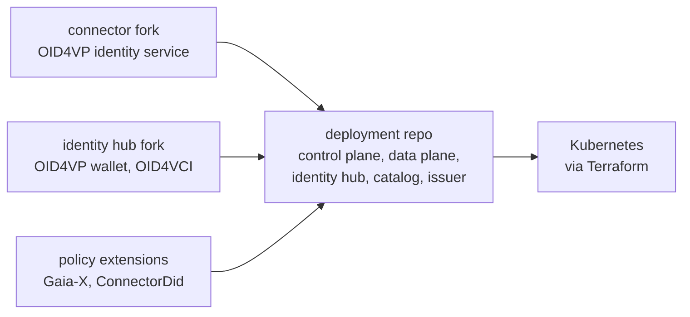
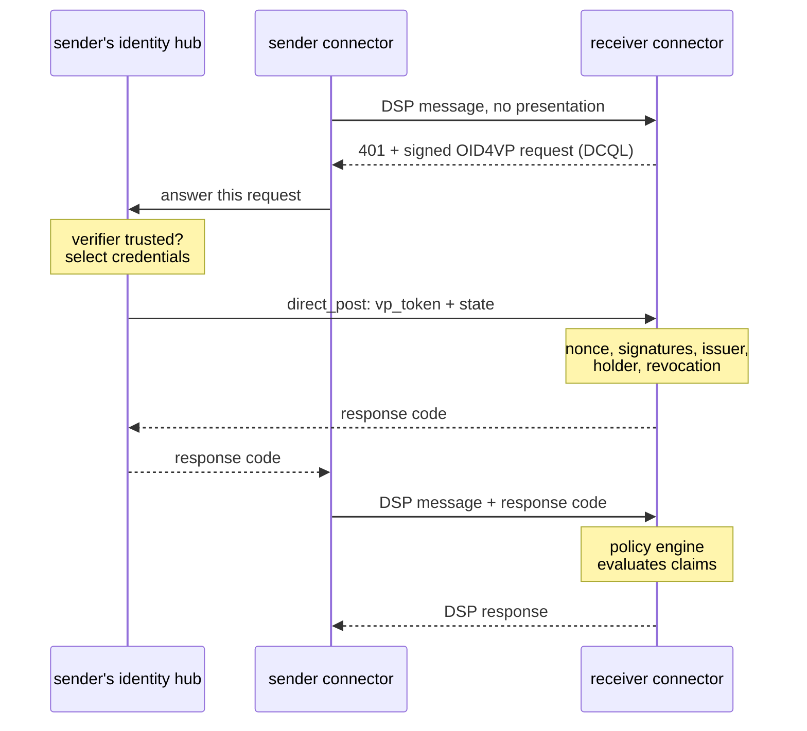

## 01 · 배경

### 데이터 공유는 "누구세요?"에서 시작합니다.

데이터 스페이스는 기업들이 중앙 플랫폼에 데이터를 넘기지 않고도 서로 데이터를 공유할 수 있게 해 줍니다. 각 기업은 자체 **커넥터**를 운영합니다. 커넥터는 제공하는 데이터를 목록으로 보여 주고, 상대방과 이용 조건에 합의한 다음, 데이터를 전송하는 소프트웨어입니다. Eclipse Dataspace Components(EDC)는 Eclipse 재단의 오픈소스 커넥터입니다.

데이터가 오가기 전에 각 커넥터는 자신이 어느 기업의 것인지 증명해야 합니다. 이때 쓰는 것이 **검증 가능한 자격증명**(verifiable credential)입니다. 사업자 등록증처럼 신뢰할 수 있는 기관이 서명한 디지털 문서입니다. 기업은 자격증명을 디지털 **지갑**에 보관했다가 요청이 오면 보여 줍니다. 자격증명을 보여 주는 것을 **프레젠테이션**(presentation)이라고 합니다.

## 02 · 문제

### EDC는 다른 언어를 쓰고 있었습니다.

EDC는 자체 프로토콜인 Decentralized Claims Protocol(DCP)로 자격증명을 다룹니다. 반면 많은 데이터 스페이스가 따르는 규칙을 정하는 유럽 이니셔티브 Gaia-X는 다른 표준 계열인 **OpenID for Verifiable Credentials**를 채택했습니다. 자격증명 발급에는 OID4VCI, 제시에는 OID4VP를 씁니다. EU 디지털 신원 지갑도 같은 표준 위에 만들어졌습니다.

그래서 EDC 커넥터는 생태계의 나머지가 옮겨 가고 있던 지갑이나 발급자와 함께 동작할 수 없었고, EDC에는 이를 바꿀 계획이 없었습니다. 제 목표는 중간 변환 계층 없이 EDC가 OpenID for Verifiable Credentials를 직접 쓰게 만드는 것이었습니다.

## 03 · 만든 것

### 저장소 세 개, 프로토콜 교체 하나.

EDC는 여러 프로젝트로 나뉘어 있어서 작업도 같은 방식으로 나뉩니다.

- **커넥터.** 상대방의 신원을 확인하는 부분입니다. DCP를 OID4VP 기반의 신원 서비스로 교체했습니다.
- **아이덴티티 허브.** 지갑입니다. 자격증명을 저장하고, 요청이 오면 프레젠테이션을 만들고(OID4VP), 발급자로부터 새 자격증명을 받습니다(OID4VCI).
- **배포.** 모든 것을 하나로 묶습니다. 각 기업이 운영하는 프로그램, Gaia-X 및 접근 정책 규칙, 그리고 전부를 Kubernetes에 배포하는 Terraform 스크립트가 들어 있습니다.

EDC의 핵심 코드는 전혀 수정하지 않았습니다. 새 모듈은 EDC의 확장 지점을 통해 꽂히는 방식입니다. 또한 Gaia-X에 특화된 부분이 없어서 어떤 EDC 데이터 스페이스에서도 동작합니다.

## 04 · 동작 방식

### 기계끼리 자격증명을 요청하기.

OID4VP는 사람을 위해 설계되었습니다. 웹사이트가 자격증명을 요청하면, 보통 리다이렉트나 QR 코드를 통해 휴대폰의 지갑 앱이 응답합니다. 커넥터는 Dataspace Protocol(DSP)로 서버끼리 통신하며, 그 사이에 브라우저도 사람도 없습니다. 그래서 표준 OID4VP 메시지를 Dataspace Protocol 안에 실어 나르는 방법을 설명하는 짧은 명세, **전송 바인딩**(transport binding)을 작성했습니다. OID4VP 메시지는 하나도 바뀌지 않습니다. 메시지가 오가는 방식만 새롭습니다.

<ol class="flow" style="--gaps: 4">
  <li><b>요청</b>한 커넥터가 신원을 증명하지 않은 채 메시지를 보냅니다. 받는 쪽은 <code>401</code>로 거절하면서, 필요한 자격증명을 DCQL 쿼리로 적은 서명된 요청을 함께 보냅니다.</li>
  <li><b>제시</b>보내는 쪽의 지갑은 요청한 상대를 신뢰하는지 확인하고, 일치하는 자격증명을 골라 서명된 프레젠테이션으로 받는 쪽에 보냅니다.</li>
  <li><b>검증</b>받는 쪽은 모든 서명을 확인하고, 각 자격증명이 신뢰할 수 있는 발급자로부터 왔는지, 보내는 쪽의 것인지, 만료되거나 폐지되지 않았는지 확인합니다.</li>
  <li><b>세션</b>받는 쪽은 수명이 짧은 코드로 응답합니다. 보내는 쪽은 이후 모든 메시지에 이 코드를 붙이므로, 메시지마다가 아니라 한 번의 검증으로 전체 교환이 끝납니다.</li>
  <li><b>정책</b>검증된 자격증명은 EDC의 정책 엔진으로 넘어가고, 정책 엔진이 이 기업이 이 데이터에 접근할 수 있는지 판단합니다.</li>
</ol>

프레젠테이션은 헤더가 아니라 요청 본문에 담겨 전송됩니다. 서명된 자격증명 하나만으로도 이미 수 킬로바이트에 달해, 많은 네트워크가 헤더 하나에 허용하는 크기를 넘기 때문입니다. 세션 코드는 수십 바이트에 불과합니다.

## 05 · 보안

### 서명은 누가 요청하는지를 말해 줄 뿐, 그럴 자격이 있는지는 말해 주지 않습니다.

유효한 서명은 누가 서명했는지만 증명합니다. 요청한 것에 대한 자격이 있다는 증명은 아닙니다. 여기서 몇 가지 보호 장치가 나옵니다.

- **신뢰할 수 있는 발급자.** 자격증명은 신뢰할 수 있는 기관이 발급한 경우에만 인정됩니다. 서명 키는 그 발급자의 것이어야 하고, 자격증명은 그것을 제시하는 기업에게 발급된 것이어야 합니다.
- **신뢰할 수 있는 검증자.** 지갑은 자체 목록에 있는 커넥터에게만 자격증명을 보여 주며, 자기 기업의 커넥터만 지갑에 지시를 내릴 수 있습니다.
- **요청 가로채기 방지.** 자격증명 요청에는 항상 받는 쪽의 설정된 주소가 들어 있고, 지갑은 다른 곳을 가리키는 요청을 거절합니다. 탈취한 요청으로 자격증명을 공격자에게 보내게 할 수 없습니다.
- **폐지.** 자격증명은 상태 목록과 대조해 확인하므로, 발급자는 이미 내준 자격증명도 취소할 수 있습니다.
- **재시작과 확장.** 요청과 세션은 데이터베이스에 저장되므로, 커넥터를 여러 개 띄워 운영할 수 있고 재시작해도 문제없습니다.

## 06 · 설계 선택

### 꽂거나, 빼거나.

- 모든 정책 규칙은 선택 사항입니다. 빌드 파일에서 한 줄을 지우면 해당 규칙이 빠지고 더 이상 적용되지 않습니다.
- 두 가지 모드로 실행할 수 있습니다. 어떤 데이터 스페이스에서든 쓸 수 있는 순수 OpenID for Verifiable Credentials 모드, 또는 그 위에 Gaia-X 라벨 검사를 더한 모드입니다.
- 자격증명은 W3C Verifiable Credentials Data Model 2.0을 따르고 JWT로 서명됩니다. OID4VP에는 이 조합에 대한 형식 이름이 등록되어 있지 않아서, 프로젝트에서는 `vc+jwt`를 씁니다.
- 기본으로 세 가지 정책 규칙이 포함됩니다. `GaiaXLabelCredential`, `GaiaXLabelLevel`, 그리고 특정 기업에만 제공을 제한하는 `ConnectorDid`입니다.

## 07 · 다음 단계

### Gaia-X Tech-X에서 발표.

아테네에서 열린 Gaia-X Tech-X 2026 본회의에서 라이브 데모와 함께 이 프로젝트를 발표했습니다. 그때 보여 준 로드맵 중 폐지 확인 기능은 이후에 구현했습니다. 나머지 로드맵은 다음과 같습니다.

- OpenID for Verifiable Credentials 모듈을 EDC 본체에 기여하는 방안 제안
- Gaia-X CTO 팀과 상호운용성 및 명세 테스트
- 실제 플랫폼에서의 성능 및 안정성 벤치마크
