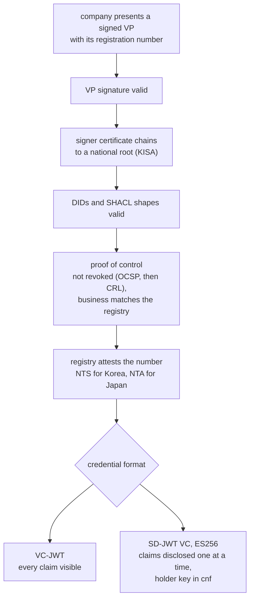
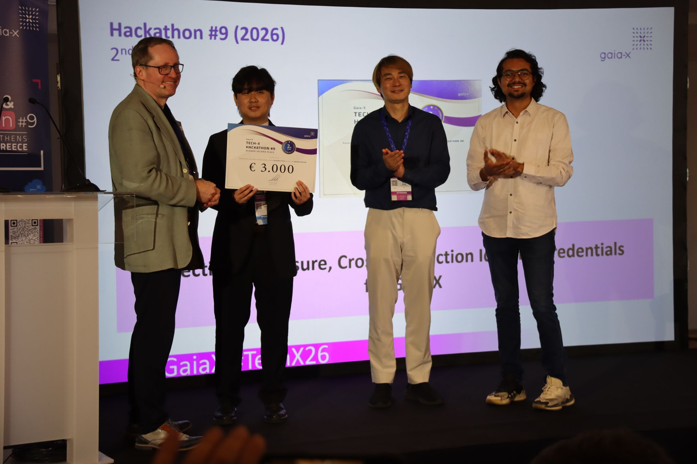

## 01 · 배경

### 데이터 스페이스에 참여하려면 실제 기업임을 증명해야 합니다.

Gaia-X는 데이터 스페이스를 위한 유럽의 이니셔티브입니다. 데이터 스페이스는 기업들이 합의된 규칙에 따라 데이터를 공유하는 네트워크입니다. 참여하려면 기업은 먼저 검증을 거쳤다는 서명된 디지털 문서인 **컴플라이언스 자격증명**을 받아야 합니다. 이 검증의 일부를 맡는 것이 **노터리**(notary)로, 공식 출처를 통해 기업의 등록번호를 확인하는 서비스입니다.

## 02 · 문제

### 참여는 느리고, 공개되는 정보는 너무 많았습니다.

문제는 두 가지였습니다.

- **유럽 밖에서는 참여가 느렸습니다.** 노터리는 EU VAT ID 같은 유럽 식별자 외에는 글로벌 기업 식별자인 LEI만 받았습니다. LEI 발급에는 비용과 시간이 들고, 영어로 일하지 않는 기업은 절차를 알아보기도 어렵습니다. 한국 기업은 모두 사업자등록번호를 이미 가지고 있으므로, 그 번호를 바로 받아 주면 이 모든 수고를 덜 수 있습니다.
- **검증할 때마다 모든 정보가 드러났습니다.** 자격증명은 모든 항목이 완전히 보이거나 아예 없는 방식으로 발급되었습니다. "이 회사는 정상 영업 중"이라는 사실만 필요한 거래처도 등록 정보 전체를 보게 되었습니다.

이 프로젝트의 핵심 아이디어는 검증을 받았다는 사실과 검증에 쓰인 데이터가 별개라는 것입니다. 검증하는 쪽에 필요한 건 앞의 것이지 뒤의 것이 아닙니다. 이름이나 주소를 보여 주지 않고도 성인임을 증명할 수 있는 신분증과 같은 원리입니다.

## 03 · 만든 것

### 국가마다 어댑터 하나, 자격증명 형식은 하나.

- **국가별 어댑터.** 공통 인터페이스 하나에 국가별 작은 모듈을 붙이는 구조입니다. 한국 모듈은 10자리 사업자등록번호를 국세청을 통해 확인합니다. 일본 모듈은 13자리 법인번호를 일본 국세청을 통해 확인합니다. 국가를 추가하려면 모듈 하나만 더 작성하면 됩니다.
- **소유 증명.** 등록번호는 공개 정보라서, 번호를 안다고 해서 그 회사라는 뜻은 아닙니다. 한국의 경우 기업은 공식 사업자 인증서로 요청에 서명해야 하며, 이 인증서는 한국의 국가 최상위 인증기관(KISA)까지 이어져야 합니다. 인증서가 폐지되었는지도 폐지 목록으로 확인합니다.
- **선택적 공개.** 자격증명을 SD-JWT라는 형식으로 발급할 수 있습니다. 각 항목이 따로 봉인되어 있어서, 기업이 거래처마다 어떤 항목을 공개할지 고를 수 있고, 거래처는 그 항목이 진짜인지 확인할 수 있습니다.
- **Gaia-X 연동.** Gaia-X 컴플라이언스 절차가 요구하는 식별자(`did:web`)와 데이터 스키마를 지원합니다.

자격증명이 발급되려면 아래의 모든 검사를 통과해야 합니다.

## 04 · 결과

### 2위, 그리고 실제 릴리스로.

2026년 5월 아테네에서 열린 Gaia-X Tech-X & Hackathon #9에서 Circular Solution 동료 한 명, smartSense Consulting Solutions의 개발자 한 명과 함께 3인 팀을 이끌었습니다. 프로젝트는 "Selective-Disclosure Cross-Jurisdiction Identity Credentials for Gaia-X"라는 이름으로 2위를 차지했고, 이후 Gaia-X Danube 릴리스에 반영되었습니다.

아테네에서 2위 수상.

## 05 · 해커톤 이후

### 프로토타입에서 제품으로.

이후 Circular Solution에서 오픈소스 확장 기능으로 계속 개발했습니다. 인증서 기반 소유 증명, ES256 알고리즘 서명, 각 자격증명을 보유자의 키에 묶는 기능, 배포용 Helm 차트와 CI 파이프라인은 모두 대회 이후에 추가했습니다.

국가별 확인 기능을 Gaia-X 노터리 자체에도 넣었습니다. 제 [머지 리퀘스트](https://gitlab.com/gaia-x/lab/compliance/gaia-x-notary-registrationnumber/-/merge_requests/96)는 새로운 식별자 유형 `gx:CountryCompanyNumber`를 추가하고, 국가마다 검증기를 하나씩 둡니다. 번호에는 VAT ID처럼 국가 접두사가 붙고, 한국 번호는 국세청을 통해 확인합니다. 단위 테스트와 엔드투엔드 테스트, 그리고 전체 컴플라이언스 흐름으로 검증했습니다.

발표에서 밝힌 다음 계획은 같은 어댑터 패턴으로 미국 EIN, 싱가포르 UEN 같은 더 많은 국가를 지원하는 것, 그리고 자격증명의 폐지 목록을 공개하는 것입니다.
