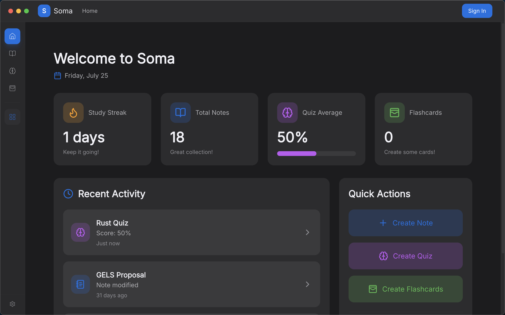
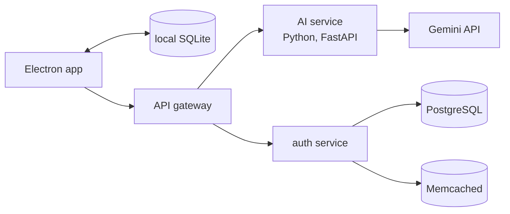

## 01 · 아이디어

### 노트를 넣으면 학습 자료가 나옵니다.

학생들은 보통 노트는 한 앱에, 플래시카드는 다른 앱에 만들고, 시험 대비는 또 다른 곳에서 합니다. Soma는 이 세 가지를 하나의 데스크톱 앱에 담았습니다. 노트를 쓰면 Soma가 그 노트로 퀴즈 문제와 플래시카드 덱을 만들어 줍니다. 대시보드에서는 연속 학습 일수, 퀴즈 평균 점수, 최근 학습 내용을 볼 수 있습니다.

노트 편집기는 개인 위키처럼 동작합니다. 노트끼리 링크하고, 태그를 달고, 검색할 수 있습니다.

Soma는 제가 예전에 만든 웹 앱 Quizify에서 출발했습니다. 학습 자료 PDF를 올리거나 프롬프트를 입력하면 시험 문제를 만들어 주는 앱이었습니다.

홈 화면.

## 02 · 아키텍처

### 노트는 내 컴퓨터에 남습니다.

Soma는 **로컬 우선(local-first)** 앱입니다. 노트, 덱, 퀴즈 결과가 사용자의 컴퓨터에 저장되므로 인터넷 연결 없이도 동작합니다. 서버는 로그인과 학습 자료 생성, 두 가지에만 필요합니다.

- **데스크톱 앱.** Electron과 React로 만들었습니다. 사용자가 만든 모든 데이터는 작은 로컬 데이터베이스(SQLite)에 저장되고, 로그인 토큰은 일반 파일이 아니라 운영체제의 보안 키체인에 보관됩니다.
- **백엔드.** API 게이트웨이가 모든 요청을 받아 알맞은 서비스로 전달합니다. Python으로 작성한 AI 서비스가 학습 자료를 생성합니다. 인증 서비스는 Google 로그인과 신뢰할 수 있는 기기 기억을 담당하며, 계정은 PostgreSQL에 저장하고 Memcached로 캐싱합니다.
- **인프라.** 각 서비스는 Docker 컨테이너로 패키징되어 있고, 백엔드는 서버를 내리기 전까지 Kubernetes에서 운영했습니다.

## 03 · 모델

### 한 가지 일을 위해 학습시킨 작은 모델.

노트를 퀴즈나 플래시카드 덱으로 바꾸려면, AI 서비스에는 앱이 읽을 수 있는 고정된 구조로 안정적으로 답하는 언어 모델이 필요합니다. 그래서 모델을 **파인튜닝**했습니다. 기존 모델인 Meta의 Llama 3.2 1B를 가져와, 바로 이 작업의 예시로 추가 학습시켰습니다.

평범한 하드웨어에서 이를 가능하게 한 두 가지 기법은 다음과 같습니다.

- **LoRA.** 10억 개의 파라미터 전체를 다시 학습시키는 대신, 작은 추가 레이어만 학습시키고 원래 모델은 그대로 둡니다. 메모리와 시간이 훨씬 적게 듭니다.
- **4비트 로딩.** 기본 모델을 낮은 수치 정밀도로 저장해, 일반 소비자용 그래픽카드 한 장의 메모리에 들어가게 합니다.

제가 학습시킬 수 있는 가장 큰 모델이 1B였습니다. 학교에서 쓸 수 있던 장비는 RAM 128GB와 RTX 4060 그래픽카드를 갖추고 있었습니다. Gemini 1.5 Flash로 학습 노트, 퀴즈 문제, 플래시카드를 아우르는 학습 예시 99개를 만들고 200스텝 동안 학습시켰습니다. 결과는 모델이 만든 퀴즈와 플래시카드를 직접 읽어 보며 평가했습니다.

졸업 발표용으로 배포한 서버는 모델을 돌리기에는 너무 작아서, 실제 서비스는 Gemini API를 대신 사용했습니다. 파인튜닝 모델을 먼저 시도하고 실패하면 Gemini로 넘어가는 코드는 저장소에 꺼진 상태로 남아 있습니다.

## 04 · 성과

### 학년 최우수.

Soma는 동서대학교에서 제 학년 최우수 졸업 프로젝트로 선정되었습니다. 학년 최고 성적과 함께, 이 프로젝트로 2025년 대학 우수학생상을 받았습니다.

또한 이 프로젝트를 「AI 기반 학습 지원 통합 데스크톱 애플리케이션의 설계 및 구현」이라는 논문으로 정리했고, 2025년 KICSP 학술대회에서 우수논문상을 받았습니다.
