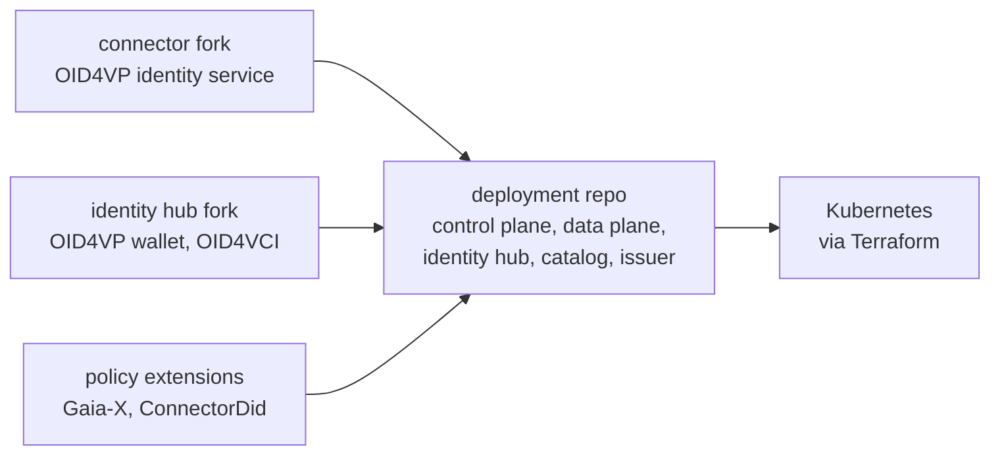
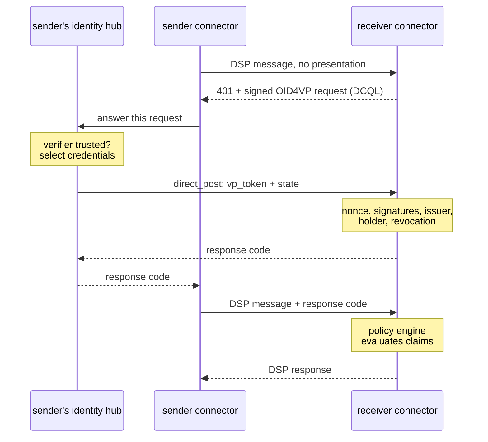

## 01 · background

### Sharing data starts with "who are you?"

A dataspace lets companies share data with each other without handing it to a central platform. Each company runs its own **connector**: software that lists the data it offers, agrees on the terms of use with the other side, and then moves the data. Eclipse Dataspace Components (EDC) is an open-source connector from the Eclipse Foundation.

Before any data moves, each connector has to prove which company it belongs to. It does this with **verifiable credentials**: digital documents, such as a company registration, that a trusted organisation has signed. A company keeps its credentials in a digital **wallet**, and shows them when asked. Showing a credential is called a **presentation**.

## 02 · the problem

### EDC spoke a different language.

EDC handles credentials with a protocol of its own, the Decentralized Claims Protocol (DCP). Gaia-X, the European initiative that sets the rules many dataspaces follow, adopted a different family of standards: **OpenID for Verifiable Credentials**, with OID4VCI for issuing credentials and OID4VP for presenting them. The EU's digital identity wallet is built on the same standards.

So an EDC connector could not work with the wallets and issuers the rest of the ecosystem was moving to, and EDC had no plan to change that. My goal was to make EDC speak OpenID for Verifiable Credentials directly, with no translation layer in between.

## 03 · what i built

### Three repositories, one protocol swap.

EDC is split into separate projects, so the work is split the same way:

- **Connector.** The part that checks the other side's identity. I replaced DCP with an identity service built on OID4VP.
- **Identity Hub.** The wallet. It stores credentials, creates presentations when asked (OID4VP), and receives new credentials from issuers (OID4VCI).
- **Deployment.** Puts everything together: the programs each company runs, the Gaia-X and access policy rules, and Terraform scripts that deploy it all to Kubernetes.

None of EDC's core code is modified: the new modules plug in through EDC's extension points. They also contain nothing specific to Gaia-X, so they work in any EDC dataspace.

## 04 · how it works

### Asking for credentials between machines.

OID4VP was designed for people. A website asks for a credential, and the wallet app on your phone answers, usually through a redirect or a QR code. Connectors are servers talking to servers over the Dataspace Protocol (DSP), with no browser and no person in the loop. So I wrote a short specification, a **transport binding**, that describes how to carry standard OID4VP messages inside the Dataspace Protocol itself. No OID4VP message is changed. Only the way it travels is new.

<ol class="flow" style="--gaps: 4">
  <li><b>challenge</b>One connector sends a message without proving who it is. The receiver refuses with <code>401</code> and attaches a signed request saying which credentials it needs, written as a DCQL query.</li>
  <li><b>present</b>The sender's wallet checks that it trusts whoever is asking, picks the matching credentials, and sends them to the receiver as a signed presentation.</li>
  <li><b>verify</b>The receiver checks every signature, that each credential comes from a trusted issuer and belongs to the sender, that nothing has expired, and that nothing has been revoked.</li>
  <li><b>session</b>It replies with a short-lived code. The sender attaches that code to every following message, so the whole exchange needs only one round of checks instead of one per message.</li>
  <li><b>policy</b>The verified credentials go to EDC's policy engine, which decides whether this company may access this data.</li>
</ol>

The presentation travels in the body of a request rather than in a header, because a single signed credential is already several kilobytes, more than many networks allow in one header. The session code is only a few dozen bytes.

## 05 · keeping it safe

### A signature says who is asking, not whether they may.

A valid signature only proves who signed something. It does not prove that they are entitled to what they ask for. Several protections follow from that:

- **Trusted issuers.** A credential only counts if a trusted organisation issued it. Its signing key must belong to that issuer, and it must have been issued to the company presenting it.
- **Trusted verifiers.** The wallet only shows credentials to connectors on its own list, and only its own company's connector can instruct it.
- **No redirected requests.** A request for credentials always names the receiver's own configured address, and the wallet refuses requests that point anywhere else. A stolen request cannot be used to send credentials to an attacker.
- **Revocation.** Credentials are checked against status lists, so an issuer can cancel one after it has been handed out.
- **Restarts and scaling.** Requests and sessions are stored in a database, so a connector can run as several copies and survive a restart.

## 06 · design choices

### Plug in, or leave out.

- Every policy rule is optional. Removing one line from a build file removes the rule and stops it being enforced.
- It can run in two modes: plain OpenID for Verifiable Credentials for any dataspace, or with Gaia-X label checks on top.
- Credentials follow the W3C Verifiable Credentials Data Model 2.0, signed as JWTs. OID4VP registers no format name for that combination, so the project uses `vc+jwt`.
- Three policy rules ship with it: `GaiaXLabelCredential`, `GaiaXLabelLevel`, and `ConnectorDid`, which limits an offer to named companies.

## 07 · next steps

### Presented at Gaia-X Tech-X.

I presented the project, with a live demo, in the plenary at Gaia-X Tech-X 2026 in Athens. Revocation checking, one item on the roadmap I showed there, has been built since. The rest of that roadmap:

- propose the OpenID for Verifiable Credentials modules as a contribution to EDC itself
- interoperability and specification tests with the Gaia-X CTO team
- performance and reliability benchmarks on real platforms
