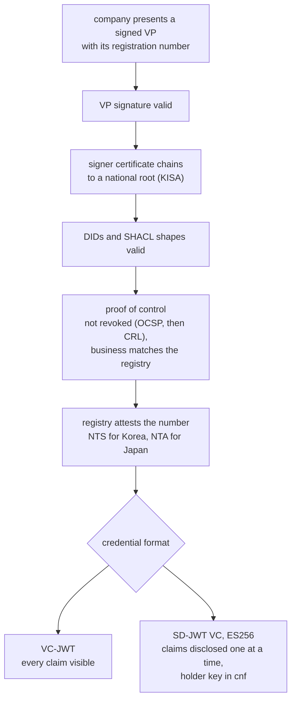
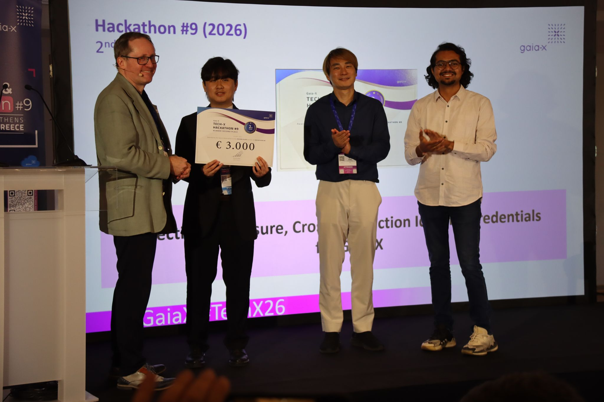

## 01 · background

### Joining a dataspace means proving you are a real company.

Gaia-X is a European initiative for dataspaces: networks where companies share data under agreed rules. To take part, a company first gets a **compliance credential**, a signed digital document saying it has been checked. Part of that check is a **notary**, a service that confirms the company's registration number with an official source.

## 02 · the problem

### Slow to get in, and too revealing.

The problem had two halves.

- **Getting in was slow outside Europe.** Apart from European identifiers such as an EU VAT ID, the notary accepted an LEI, a global company identifier. Getting an LEI costs money and takes time, and the process is hard to research for companies that don't work in English. Every Korean company already has a business registration number, so accepting that number directly saves them all of that.
- **Every check revealed everything.** Credentials were issued so that every detail in them was either fully visible or missing. A business partner who only needed to know "this company is still active" saw its full registration record as well.

The idea behind the project is that the fact of being verified is separate from the data that was checked. A verifier needs the first, not the second. It works like an ID card that could prove you are over eighteen without showing your name or address.

## 03 · what we built

### One adapter per country, one credential format.

- **Country adapters.** A shared interface with one small module per country. The Korea module checks the 10-digit business registration number with the National Tax Service. The Japan module checks the 13-digit corporate number with the National Tax Agency. Adding a country means writing one more module.
- **Proof of control.** A registration number is public, so knowing one does not make you that company. For Korea, the company signs its request with its official business certificate, which has to trace back to Korea's national root certificate authority (KISA). The certificate is also checked against revocation lists, in case it has been cancelled.
- **Selective disclosure.** Credentials can be issued in a format called SD-JWT. Each detail is sealed separately, and the company decides which ones to reveal to each partner, who can still confirm they are genuine.
- **Gaia-X plumbing.** Support for the identifiers (`did:web`) and data schemas the Gaia-X compliance process expects.

Every check below has to pass before a credential is issued:

## 04 · result

### Second place, then shipped.

I led a team of three at Gaia-X Tech-X & Hackathon #9 in Athens in May 2026, with a colleague from Circular Solution and a developer from smartSense Consulting Solutions. The project took second place, as "Selective-Disclosure Cross-Jurisdiction Identity Credentials for Gaia-X", and the work then went into the Gaia-X Danube release.

Collecting second place in Athens.

## 05 · after the hackathon

### From prototype to product.

I kept building it as an open-source extension at Circular Solution. The certificate-based proof of control, signing with the ES256 algorithm, binding each credential to its holder's key, and a Helm chart and CI pipeline for deployment were all added after the event.

I also brought the country check into the Gaia-X notary itself. My [merge request](https://gitlab.com/gaia-x/lab/compliance/gaia-x-notary-registrationnumber/-/merge_requests/96) adds a new identifier type, `gx:CountryCompanyNumber`, with one validator per country. Numbers carry a country prefix, the way VAT IDs do, and Korean numbers are checked with the National Tax Service. It was tested with unit and end-to-end tests and through the full compliance flow.

Next on the list from our presentation: more countries using the same adapter pattern, such as US EINs and Singapore UENs, and publishing revocation lists for the credentials.
