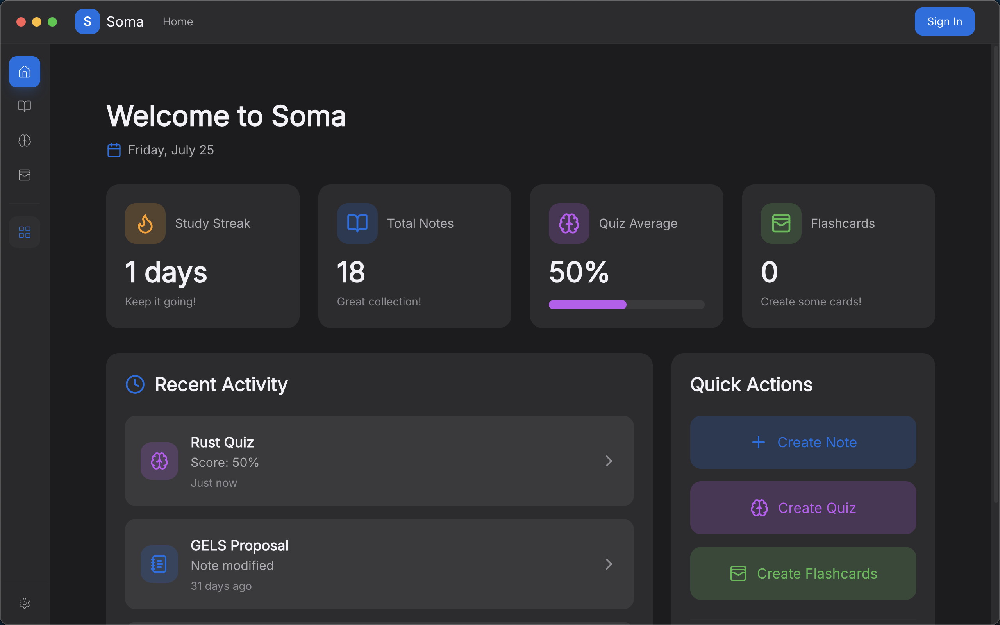
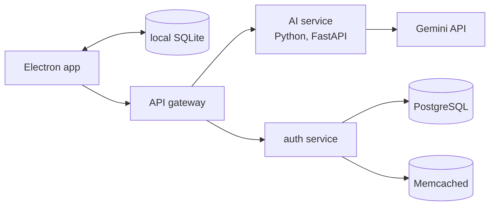

## 01 · the idea

### Notes in, study material out.

Students usually keep notes in one app, make flashcards in another, and test themselves somewhere else. Soma puts all three in one desktop app. You write notes, and Soma generates quiz questions and flashcard decks from them. A dashboard shows your study streak, your quiz average and what you worked on recently.

The note editor works like a personal wiki: notes can link to each other, carry tags, and be searched.

Soma grew out of Quizify, an earlier web app of mine. You uploaded a PDF of study material, or typed a prompt, and it generated a test for you.

The home screen.

## 02 · architecture

### Your notes stay on your machine.

Soma is **local-first**: your notes, decks and quiz results are stored on your own computer, so the app works without an internet connection. The server is only needed for two things, signing in and generating study material.

- **Desktop app.** Built with Electron and React. Everything you create is saved in a small local database (SQLite), and your sign-in token is kept in the operating system's secure keychain rather than in a plain file.
- **Backend.** An API gateway receives every request and forwards it to the right service. The AI service, written in Python, generates study material. The authentication service handles Google sign-in and remembers trusted devices, storing accounts in PostgreSQL and caching with Memcached.
- **Infrastructure.** Each service is packaged as a Docker container, and the backend ran on Kubernetes until I took the server down.

## 03 · the model

### A small model, trained for one job.

To turn a note into a quiz or a flashcard deck, the AI service needs a language model that reliably answers in a fixed structure the app can read. I **fine-tuned** one for that: I took an existing model, Meta's Llama 3.2 1B, and trained it further on examples of exactly this task.

Two techniques made that possible on modest hardware:

- **LoRA.** Instead of retraining all one billion parameters, LoRA trains a small add-on layer and leaves the original model untouched. It needs far less memory and time.
- **4-bit loading.** The base model is stored at lower numerical precision, so it fits in the memory of a single consumer graphics card.

A 1B model was the largest I could train. The school's machine for this had 128 GB of RAM and an RTX 4060 graphics card. I generated 99 training examples with Gemini 1.5 Flash, covering study notes, quiz questions and flashcards, and trained for 200 steps. I judged the results by reading the quizzes and flashcards the model produced.

The server I deployed to for the capstone presentation was too small to run the model, so the live service used the Gemini API instead. The code that tries the fine-tuned model first and falls back to Gemini is still in the repository, switched off.

## 04 · recognition

### Best of the batch.

Soma was rated the best capstone project of my batch at Dongseo University. Together with having the best grades in the batch, it earned me the university's Outstanding Student Award in 2025.

I also wrote it up as a paper, "Design and Implementation of an AI-Based Integrated Desktop Application for Study Support", which received an Excellent Paper Award at the 2025 KICSP Conference.
